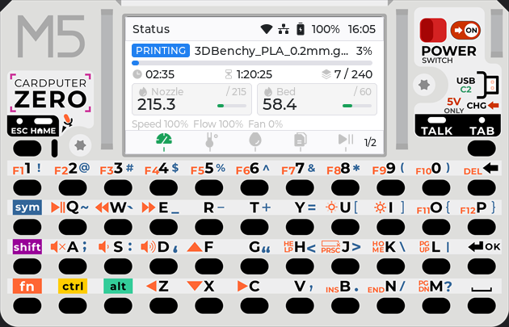
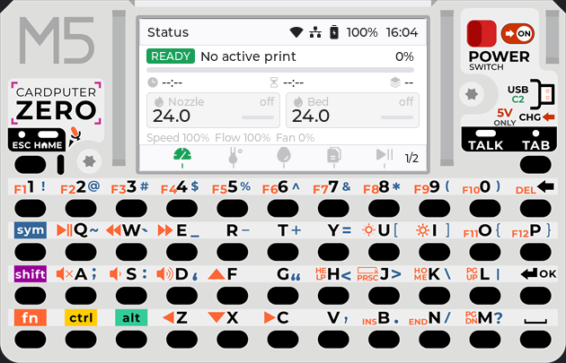
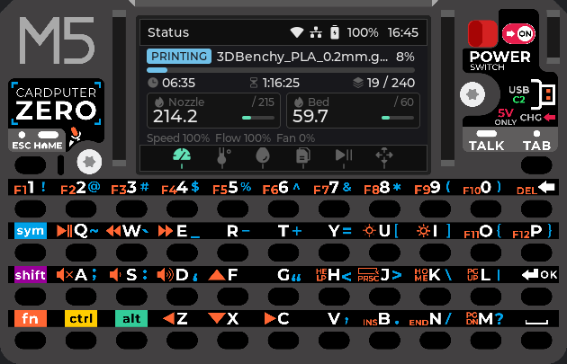
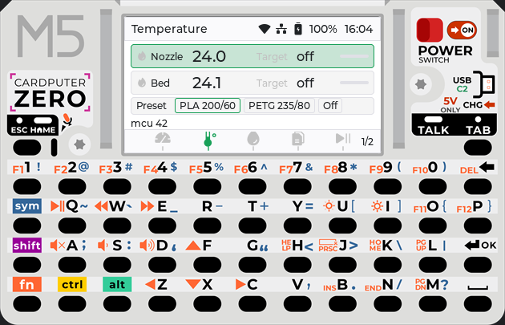
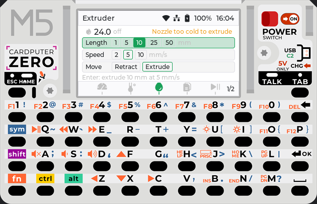
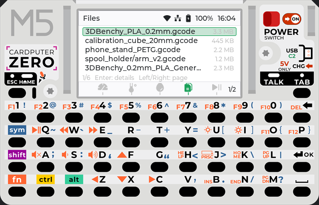
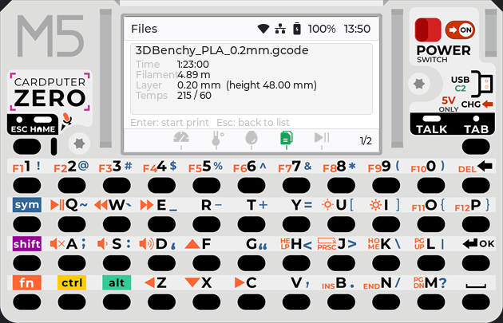
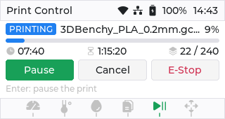
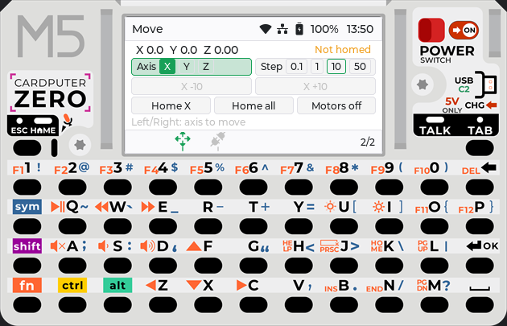
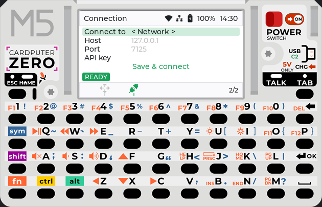

# KlipperDeckZero

[English](README.md) | 日本語 | [简体中文](README.zh-CN.md)

M5Stack **CardputerZero** に Klipper / Moonraker を載せ、本体の画面とキーボードから 3D プリンターを操作するための LVGL アプリです。

> 🚧 開発中です。第2段階(温度設定・押し出し/引き戻し・ファイル選択・印刷制御・軸の移動の操作画面)まで実装済みです。

## できるようにしたいこと

- プリンターの状態表示(状態、進捗、経過/残り時間、ノズル・ベッド温度、印刷中のファイルのサムネイルなど)
- G-code ファイルの選択と印刷開始、一時停止/再開/中止
- ホットエンド・ベッドの昇温指示
- フィラメントの押し出し(Extrude)と引き戻し(Retract)
- 軸の移動(ジョグ)、ホーミング、モーターのオフ

## 構成

- ベース: [CardputerZero/Template](https://github.com/CardputerZero/Template)(C++17 / LVGL 9.5 / CMake)
- プリンター制御: [Moonraker](https://moonraker.readthedocs.io/) の JSON-RPC API
  - 実機: Unix ソケット(`~/printer_data/comms/moonraker.sock`)
  - デスクトップシミュレーター: WebSocket(`ws://<printer-ip>:7125/websocket`)

## 画面と操作

### 画面構成



どの画面も同じ枠組みです。

- **タイトルバー**: 左に画面名、右にネットワーク接続(Wi-Fi の電波強度 / 有線)、バッテリー残量、時計を出す。
- **状態バッジ**: プリンターの状態(`OFFLINE` / `STARTING` / `READY` / `PRINTING` / `PAUSED` / `COMPLETE` / `CANCELLED` / `ERROR` / `SHUTDOWN`)を色分けして出す。状態表示と印刷制御では、横にファイル名と進捗バーが並ぶ。
- **内容エリア**: 画面ごとの表示と操作項目。選んでいる項目は緑で示す。
- **最下行**: 選んでいる項目の操作のヒントや、エラーなどのメッセージ。状態表示では Speed / Flow / Fan を出す。
- **ナビバー**: 画面下部に 5 つのスロットを並べる。各スロットはキーボードの `4`〜`8` のキーの真上にあり、押すキーと位置がそろっている。スロットはレイヤーに分かれていて(いまは 2 枚)、`Sym`+`H` / `Sym`+`J` で前 / 次のレイヤーに切り替える。右端に今のレイヤー(`1/2` など)を出す。現在の画面のアイコンは緑になり(表示中のレイヤーにない画面なら緑のアイコンはない)、空きスロットは無地で選べない。
- **トースト**: 操作の結果(成功 / Klipper のエラー)や「Printer is not ready」などを、画面下部に一時的に出す。
- **テーマ**: ライト / ダークを `D` で切り替える。

> この README のスクリーンショットは、デスクトップシミュレーターを疑似 Moonraker(fake_moonraker)に接続して撮影したものです。本体フレームとバーチャルキーボードを含めて表示しています(キーボード上の記号はシミュレーターでのキー割り当ての目安です)。撮り直し方は「[README のスクリーンショット](#readme-のスクリーンショット)」を参照してください。

### 画面一覧

| レイヤー | キー | 画面 | 役割 |
|---|---|---|---|
| 1 | `4` | 状態表示(ホーム) | 状態、進捗、経過 / 残り時間、レイヤー、ノズル・ベッド温度、速度・流量・ファン |
| 1 | `5` | 温度設定 | ノズル・ベッドの目標温度、プリセット |
| 1 | `6` | 押し出し / 引き戻し | フィラメントの押し出し(Extrude)と引き戻し(Retract) |
| 1 | `7` | ファイル選択と印刷開始 | G-code ファイルの一覧と詳細、印刷開始 |
| 1 | `8` | 印刷制御 | 一時停止 / 再開、中止、非常停止 |
| 2 | `4` | 軸の移動 | ジョグ、ホーミング、モーターオフ |
| 2 | `5` | 接続設定(`S` でも開く) | 接続先(この端末の Klipper / ネットワーク上のプリンター) |
| 2 | `6`〜`8` | (空き) | 今後の画面用 |

レイヤーと画面は独立しています。レイヤーを切り替えても変わるのはナビバーの表示(どのキーでどの画面を開くか)だけで、画面はそのままです。画面が変わるのは `4`〜`8`・`S`・`ESC` を押したときだけで、そのときもレイヤーは切り替わりません。

| レイヤー 1 を表示 | `Sym`+`J` でレイヤー 2 を表示 |
|---|---|
|  |  |

右の状態で `4` を押すと軸の移動、`5` を押すと接続設定が開きます。

### 共通のキー操作

| キー | 動作 |
|---|---|
| `4`〜`8` | 表示中のレイヤーのスロットの画面へ切り替え(上の画面一覧) |
| `Sym`+`H` / `Sym`+`J` | 前 / 次のレイヤーへ切り替え(シミュレーターは `<` / `>`) |
| `S` | 接続設定(表示中のレイヤーは変わらない) |
| `ESC` | ホーム(状態表示)へ戻る(表示中のレイヤーは変わらない) |
| `4` / `ESC` 長押し | 終了(ホームで押したときのみ。`4` はレイヤー 1 を表示しているときだけ) |
| `D` | ライト / ダーク切替 |
| `R` / `F` | Klipper 再起動(`RESTART`) / MCU 再起動(`FIRMWARE_RESTART`)。状態表示で 3 秒以内に 2 回押すと実行。Klipper が ready で印刷中・一時停止中のときは実行しない |
| `Fn`+`H` | ヘルプ |
| `Fn`+`J` | スクリーンショット(`~/Pictures/Screenshots` に PNG 保存。シミュレーターは `PrintScreen` キー) |

各画面では `↑`/`↓` で項目を選び、`←`/`→` で値や選択肢を切り替え、`Enter` で実行します。数字を打ち込んでいる間は、すべてのキーを画面が受け取ります(`6` を打ってもページは切り替わりません)。

#### 状態表示(レイヤー 1 の `4`)

| 印刷中(ライト) | 印刷中(ダーク) |
|---|---|
|  |  |


状態バッジ・ファイル名・進捗(%)、経過 / 残り時間・レイヤー、ノズル・ベッドの現在温度と目標温度・ヒーター出力、最下行に Speed / Flow / Fan を出します。印刷していないときは「No active print」です。印刷中・一時停止中は、ファイルのサムネイルを上の 3 行の左に出します(デスクトップのシミュレーターでは、疑似 Moonraker がファイルのメタデータで `thumbnails` を空で返すため出ません)。

この画面で `R` / `F` を 3 秒以内に 2 回押すと、Klipper / MCU を再起動します。Klipper が ready で印刷中・一時停止中のときは実行しません。Klipper の起動中・切断中や、エラー(`error`・`shutdown`)の間は、印刷状態が古いままでも再起動できるので、Klipper が止まった後の復旧に使えます。

#### 温度設定(レイヤー 1 の `5`)



`↑`/`↓` でノズル・ベッド・プリセットを選びます(ベッドがない構成ではベッドの行を出しません)。

- ノズル・ベッド: `←`/`→` で目標温度を 5 刻みで上下し、`Enter` で数字を打ち込めます。もう一度 `Enter` で送信、`ESC` で取消です。上限はノズル 350、ベッド 150(実際の上限は Klipper の `max_temp` が判定します)。
- プリセット(PLA 200/60、PETG 235/80、Off): `←`/`→` で選び、`Enter` で両方のヒーターに設定します。

目標温度は `SET_HEATER_TEMPERATURE` で送り、結果をトーストで表示します。最下行には、ノズル・ベッド以外の温度センサー(`temperature_sensor` など)と、この端末の CPU 温度を表示します。

#### 押し出し / 引き戻し(レイヤー 1 の `6`)



`↑`/`↓` で長さ(1/5/10/25/50 mm)・速度(2/5/10 mm/s)・向き(Retract / Extrude)を選び、`←`/`→` で切り替えます。`Enter` でどの行からでも実行します。画面上部にノズル温度と、押し出せるかどうかを出します。

- 実行しない: 印刷中、ノズルが押し出せる温度(Klipper の `min_extrude_temp`)に達していないとき。
- 一時停止中は実行できます(フィラメント交換のため)。

`SAVE_GCODE_STATE` → `M83` → `G1 E<±長さ> F<速度×60>`(`F` は mm/min) → `RESTORE_GCODE_STATE` を送るので、印刷側の押し出しモードは変わりません。

#### ファイル選択と印刷開始(レイヤー 1 の `7`)

| 一覧 | 詳細 |
|---|---|
|  |  |

プリンターの G-code ファイルを新しい順に並べます(画面を開くたびに取り直します)。`↑`/`↓` で選び(`←`/`→` で 5 件ずつ移動)、`Enter` で詳細(サムネイル・予想時間・フィラメント量・レイヤー高さ・初層温度)を表示します。

詳細でもう一度 `Enter` を押すと印刷を開始し、開始できたら状態表示に戻ります。開始に失敗したときはトーストに理由を出し、Files 画面のままです。`ESC` で一覧に戻ります。印刷中・一時停止中は開始しません。

#### 印刷制御(レイヤー 1 の `8`)



上部に状態バッジ・ファイル名・進捗・経過 / 残り時間・レイヤーを出します。`←`/`→` でボタンを選びます。

- Pause / Resume: `Enter` で一時停止・再開。一時停止中はラベルが Resume になります。
- Cancel: 3 秒以内に `Enter` を 2 回押すと中止。1 回目でボタンが赤くなり、ほかのキーを押すと取り消します。
- E-Stop: `Enter` を長押しすると非常停止(`printer.emergency_stop`)。Klipper が ready でなくても、Moonraker につながっていれば送ります。

印刷していないときは Pause と Cancel が灰色になり、押しても「No print is running」と出るだけです。非常停止の後は、状態表示で `F` を 2 回押して `FIRMWARE_RESTART` すると復帰します。

#### 軸の移動(レイヤー 2 の `4`)



`↑`/`↓` で項目(軸 / 移動量 / `−` 方向 / `+` 方向 / その軸のホーム / 全軸ホーム / モーターオフ)を選びます。軸(X/Y/Z)と移動量(0.1/1/10/50 mm)は `←`/`→` で切り替え、ほかの項目は `Enter` で実行します。画面上部にツールヘッドの位置とホーム済みの軸(「Not homed」、または「Homed」の後に軸名)を出します。

- ジョグ: `SAVE_GCODE_STATE` → `G91` → `G1 <軸><±移動量> F<送り>`(XY 3000 / Z 600 mm/min) → `RESTORE_GCODE_STATE` を送るので、印刷側の位置決めモードは変わりません。
- ホーム: `G28`(全軸) / `G28 X`(その軸)。モーターオフ: `M84`。

実行しない条件(理由はトーストと最下行に出します):

- 印刷中: すべて。
- 一時停止中: ホームとモーターオフ(一時停止位置を失うため)。ジョグはできます。
- ホームしていない軸のジョグ: 「Home the axis first」と出します。

#### 接続設定(レイヤー 2 の `5`、または `S`)



`↑`/`↓` で項目を選び、`Enter` で編集・確定、`←`/`→` で選択肢を切り替え、`ESC` で編集取消 / 戻るです。接続先は「このデバイス(Unix ソケット)」と「ネットワーク(WebSocket、Host / Port / API key)」から選べ、「Save & connect」で保存して接続し直します。最下行には常に状態バッジを出し、その横に通常は接続状態を、保存結果や入力エラーがある間はそのメッセージを出します。

## ロードマップ

1. ✅ Moonraker 通信層 + 状態表示画面
2. ✅ 温度設定、押し出し/引き戻し、ファイル選択、印刷制御、軸の移動の画面

## ビルド

[CardputerZero/Template](https://github.com/CardputerZero/Template) と同じ CMake Presets を使います。

### Windows デスクトップシミュレーター(MinGW)

前提: CMake 3.31+, Ninja, MinGW-w64(WinLibs など), vcpkg(`VCPKG_ROOT` を設定)

```powershell
cmake --preset win32-mingw64
cmake --build build/mingw64 --config Debug
./build/mingw64/Debug/klipper-deck-zero.exe
```

MSVC の場合は `win32-msvc` プリセット(`build/msvc`)を使います。

### 実機(CardputerZero)向けクロスビルド / パッケージ

```sh
cmake --workflow --preset cp0-cross-package   # dist/KlipperDeckZero_*_arm64.deb
REMOTE_USER=pi REMOTE_HOST=<ip> ./deploy.sh
```

## 設定ファイル

- デスクトップ: `config/klipper-deck-zero.conf`
- 実機: `/etc/klipper-deck-zero.conf`(ユーザー設定は `~/.config/klipper-deck-zero/klipper-deck-zero.conf`)

```ini
[moonraker]
# unix: この端末の Klipper / websocket: 別の機械の Klipper
# (既定: 実機=unix, シミュレーター=websocket で 127.0.0.1)
transport=websocket
socket_path=~/printer_data/comms/moonraker.sock
# websocket のときの接続先(ws://<host>:<port>/websocket)
host=192.168.1.50
port=7125
# trusted_clients に入っていない場合のみ
#api_key=
```

## プリンターなしで動かす(疑似 Moonraker)

デスクトップビルドには `fake_moonraker` が含まれます。ヒーター昇温・押し出し温度チェック・印刷進捗・非常停止・FW再起動を模擬します。

```powershell
./build/mingw64/Debug/fake_moonraker.exe --speed 20   # ws://127.0.0.1:7125/websocket
./build/mingw64/Debug/klipper-deck-zero.exe
```

実機につなぐ場合は `host=<プリンターIP>` に変更します。

### README のスクリーンショット

`docs/images/screen-*.png` は、デスクトップシミュレーターを疑似 Moonraker につないで撮っています。画面を変えたときは、Debug ビルドの後に次のスクリプトで全部撮り直せます(ポート 7125 を空けておいてください)。

```powershell
./tools/readme_screenshots/capture.ps1
```

シミュレーターのウィンドウにキー操作を送り、アプリのスクリーンショット機能で保存した画面(320x170)を本体フレームの画像に重ねて保存します。ウィンドウが画面に見えている必要はありません。`D` で切り替えたテーマは終了時に元に戻します。

## テスト

LVGL に依存しない部分のユニットテストです。Moonraker クライアント(JSON-RPC / 状態マージ / 接続シーケンス)、設定の読み込み・保存、各画面の操作ロジック(接続設定のフォーム・ファイル一覧・温度・押し出し・印刷制御・移動)、G-code の状態の保存と復元、サムネイルの選び方、再起動の確認、ナビバーのレイヤーなどを確かめます。LVGL なしでも単独でビルドできます。

```powershell
ctest --test-dir build/mingw64 -C Debug            # プリセットビルドに含まれる
# もしくは単独で
cmake -S tests -B build/tests -G Ninja && cmake --build build/tests && ./build/tests/kdz_tests
```

## ドキュメント

- [設計ドキュメント](docs/design/README.md)(接続の仕組み、操作画面の設計)
- [Moonraker API × CardputerZero 技術調査メモ](docs/moonraker_tech_notes.md)
