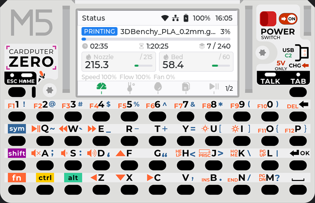
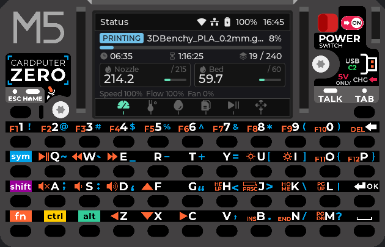
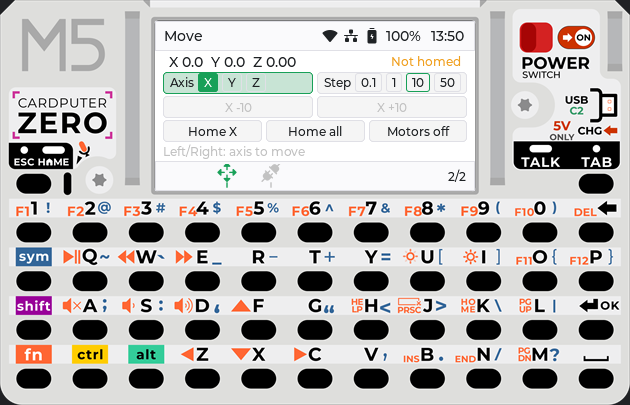

# KlipperDeckZero

English | [日本語](README.ja.md) | [简体中文](README.zh-CN.md)

An LVGL app that puts Klipper / Moonraker on the M5Stack **CardputerZero** so you can control a 3D printer from the device's own screen and keyboard.

> 🚧 Under development. Stage 2 (control screens for temperature, extrude/retract, file selection, print control, and axis movement) is implemented.

## Goals

- Printer status display (state, progress, elapsed/remaining time, nozzle and bed temperatures, thumbnail of the file being printed, etc.)
- Select G-code files and start printing; pause/resume/cancel
- Set hotend and bed heating targets
- Filament extrude (Extrude) and retract (Retract)
- Axis movement (jogging), homing, motors off

## Architecture

- Base: [CardputerZero/Template](https://github.com/CardputerZero/Template) (C++17 / LVGL 9.5 / CMake)
- Printer control: [Moonraker](https://moonraker.readthedocs.io/) JSON-RPC API
  - Device: Unix socket (`~/printer_data/comms/moonraker.sock`)
  - Desktop simulator: WebSocket (`ws://<printer-ip>:7125/websocket`)

## Screens and controls

### Screen layout



Every screen shares the same frame.

- **Title bar**: screen name on the left; network connection (Wi-Fi signal strength / wired), battery level, and clock on the right.
- **Status badge**: shows the printer state (`OFFLINE` / `STARTING` / `READY` / `PRINTING` / `PAUSED` / `COMPLETE` / `CANCELLED` / `ERROR` / `SHUTDOWN`), color-coded. On the status and print control screens, the file name and a progress bar sit next to it.
- **Content area**: each screen's information and controls. The selected item is shown in green.
- **Bottom row**: hints for the selected item, or messages such as errors. The status screen shows Speed / Flow / Fan here.
- **Nav bar**: five slots along the bottom of the screen. Each slot sits directly above the `4`–`8` keys on the keyboard, so the key you press lines up with its slot. Slots are grouped into layers (currently 2); `Sym`+`H` / `Sym`+`J` switches to the previous / next layer. The current layer (e.g. `1/2`) is shown at the right end. The current screen's icon is green (if the screen isn't on the displayed layer, no icon is green), and empty slots are blank and can't be selected.
- **Toast**: briefly shows operation results (success / Klipper errors) or messages like "Printer is not ready" at the bottom of the screen.
- **Theme**: `D` toggles light / dark.

> The screenshots in this README were taken with the desktop simulator connected to a fake Moonraker (fake_moonraker). They include the device frame and the virtual keyboard (the labels on the keyboard indicate the simulator's key assignments). See "[README screenshots](#readme-screenshots)" for how to retake them.

### Screen list

| Layer | Key | Screen | Purpose |
|---|---|---|---|
| 1 | `4` | Status (home) | State, progress, elapsed / remaining time, layer, nozzle and bed temperatures, speed, flow, fan |
| 1 | `5` | Temperature | Nozzle and bed target temperatures, presets |
| 1 | `6` | Extrude / retract | Filament extrude (Extrude) and retract (Retract) |
| 1 | `7` | File selection and print start | G-code file list and details, start printing |
| 1 | `8` | Print control | Pause / resume, cancel, emergency stop |
| 2 | `4` | Axis movement | Jogging, homing, motors off |
| 2 | `5` | Connection settings (also opened with `S`) | Connection target (Klipper on this device / a printer on the network) |
| 2 | `6`–`8` | (empty) | Reserved for future screens |

Layers and screens are independent. Switching layers only changes what the nav bar shows (which key opens which screen); the current screen stays as it is. The screen changes only when you press `4`–`8`, `S`, or `ESC`, and even then the layer does not change.

| Layer 1 displayed | Layer 2 displayed with `Sym`+`J` |
|---|---|
|  |  |

In the state on the right, pressing `4` opens axis movement and `5` opens connection settings.

### Common key controls

| Key | Action |
|---|---|
| `4`–`8` | Switch to the screen in that slot of the displayed layer (see the screen list above) |
| `Sym`+`H` / `Sym`+`J` | Switch to the previous / next layer (`<` / `>` in the simulator) |
| `S` | Connection settings (the displayed layer does not change) |
| `ESC` | Return to home (status screen) (the displayed layer does not change) |
| Long-press `4` / `ESC` | Quit (only when pressed on the home screen; `4` only while layer 1 is displayed) |
| `D` | Toggle light / dark |
| `R` / `F` | Restart Klipper (`RESTART`) / restart MCU (`FIRMWARE_RESTART`). Runs when pressed twice within 3 seconds on the status screen. Not run while Klipper is ready and printing or paused |
| `Fn`+`H` | Help |
| `Fn`+`J` | Screenshot (saved as PNG to `~/Pictures/Screenshots`; the `PrintScreen` key in the simulator) |

On each screen, `↑`/`↓` selects an item, `←`/`→` changes a value or option, and `Enter` executes. While you are typing a number, the screen receives every key (typing `6` won't switch pages).

#### Status (`4` on layer 1)

| Printing (light) | Printing (dark) |
|---|---|
|  |  |


Shows the status badge, file name, and progress (%); elapsed / remaining time and layer; nozzle and bed current and target temperatures and heater power; and Speed / Flow / Fan on the bottom row. When nothing is printing it shows "No active print". While printing or paused, the file's thumbnail appears to the left of the top three rows (it does not appear in the desktop simulator, because the fake Moonraker returns empty `thumbnails` in the file metadata).

On this screen, pressing `R` / `F` twice within 3 seconds restarts Klipper / the MCU. It does not run while Klipper is ready and printing or paused. While Klipper is starting up or disconnected, or in an error state (`error`, `shutdown`), you can restart even if the print state is stale, so you can use this to recover after Klipper has stopped.

#### Temperature (`5` on layer 1)


`↑`/`↓` selects the nozzle, bed, or preset (the bed row is hidden on setups without a bed).

- Nozzle / bed: `←`/`→` raises or lowers the target temperature in steps of 5, and `Enter` lets you type a number. Press `Enter` again to send, or `ESC` to cancel. The limits are 350 for the nozzle and 150 for the bed (the actual limit is enforced by Klipper's `max_temp`).
- Presets (PLA 200/60, PETG 235/80, Off): `←`/`→` selects one, and `Enter` applies it to both heaters.

Target temperatures are sent with `SET_HEATER_TEMPERATURE`, and the result is shown in a toast. The bottom row shows temperature sensors other than the nozzle and bed (such as `temperature_sensor`) and this device's CPU temperature.

#### Extrude / retract (`6` on layer 1)


`↑`/`↓` selects length (1/5/10/25/50 mm), speed (2/5/10 mm/s), or direction (Retract / Extrude), and `←`/`→` changes the value. `Enter` executes from any row. The top of the screen shows the nozzle temperature and whether extrusion is possible.

- Not executed: while printing, or when the nozzle has not reached extrusion temperature (Klipper's `min_extrude_temp`).
- Allowed while paused (for filament changes).

It sends `SAVE_GCODE_STATE` → `M83` → `G1 E<±length> F<speed×60>` (`F` is in mm/min) → `RESTORE_GCODE_STATE`, so the print's extrusion mode is left unchanged.

#### File selection and print start (`7` on layer 1)

| List | Details |
|---|---|
|  |  |

Lists the printer's G-code files, newest first (re-fetched each time the screen opens). `↑`/`↓` selects (`←`/`→` moves 5 at a time), and `Enter` shows details (thumbnail, estimated time, filament amount, layer height, first-layer temperatures).

Pressing `Enter` again in the details starts the print and, once it has started, returns to the status screen. If starting fails, a toast shows the reason and you stay on the Files screen. `ESC` returns to the list. Printing won't start while a print is running or paused.

#### Print control (`8` on layer 1)


The top shows the status badge, file name, progress, elapsed / remaining time, and layer. `←`/`→` selects a button.

- Pause / Resume: `Enter` pauses or resumes. While paused, the label changes to Resume.
- Cancel: press `Enter` twice within 3 seconds to cancel. The first press turns the button red; pressing any other key aborts.
- E-Stop: long-press `Enter` for an emergency stop (`printer.emergency_stop`). It is sent as long as Moonraker is connected, even if Klipper is not ready.

When nothing is printing, Pause and Cancel are grayed out, and pressing them only shows "No print is running". After an emergency stop, recover by pressing `F` twice on the status screen to run `FIRMWARE_RESTART`.

#### Axis movement (`4` on layer 2)



`↑`/`↓` selects an item (axis / step / `−` direction / `+` direction / home that axis / home all / motors off). Axis (X/Y/Z) and step (0.1/1/10/50 mm) are changed with `←`/`→`; the other items execute with `Enter`. The top of the screen shows the toolhead position and the homed axes ("Not homed", or "Homed" followed by the axis names).

- Jog: sends `SAVE_GCODE_STATE` → `G91` → `G1 <axis><±distance> F<feed rate>` (XY 3000 / Z 600 mm/min) → `RESTORE_GCODE_STATE`, so the print's positioning mode is left unchanged.
- Home: `G28` (all axes) / `G28 X` (that axis). Motors off: `M84`.

Conditions under which nothing is executed (the reason is shown in a toast and on the bottom row):

- While printing: everything.
- While paused: homing and motors off (they would lose the pause position). Jogging is allowed.
- Jogging an axis that hasn't been homed: shows "Home the axis first".

#### Connection settings (`5` on layer 2, or `S`)


`↑`/`↓` selects an item, `Enter` edits / confirms, `←`/`→` changes an option, and `ESC` cancels editing / goes back. The connection target can be "this device (Unix socket)" or "network (WebSocket, Host / Port / API key)"; "Save & connect" saves and reconnects. The bottom row always shows the status badge, next to which it normally shows the connection state, or the message while a save result or input error is pending.

## Roadmap

1. ✅ Moonraker communication layer + status screen
2. ✅ Screens for temperature, extrude/retract, file selection, print control, and axis movement

## Build

Uses the same CMake Presets as [CardputerZero/Template](https://github.com/CardputerZero/Template).

### Windows desktop simulator (MinGW)

Prerequisites: CMake 3.31+, Ninja, MinGW-w64 (WinLibs, etc.), vcpkg (with `VCPKG_ROOT` set)

```powershell
cmake --preset win32-mingw64
cmake --build build/mingw64 --config Debug
./build/mingw64/Debug/klipper-deck-zero.exe
```

For MSVC, use the `win32-msvc` preset (`build/msvc`).

### Cross build / package for the device (CardputerZero)

```sh
cmake --workflow --preset cp0-cross-package   # dist/KlipperDeckZero_*_arm64.deb
REMOTE_USER=pi REMOTE_HOST=<ip> ./deploy.sh
```

## Configuration file

- Desktop: `config/klipper-deck-zero.conf`
- Device: `/etc/klipper-deck-zero.conf` (user settings in `~/.config/klipper-deck-zero/klipper-deck-zero.conf`)

```ini
[moonraker]
# unix: Klipper on this device / websocket: Klipper on another machine
# (default: device = unix, simulator = websocket at 127.0.0.1)
transport=websocket
socket_path=~/printer_data/comms/moonraker.sock
# websocket destination (ws://<host>:<port>/websocket)
host=192.168.1.50
port=7125
# only needed when the client is not in trusted_clients
#api_key=
```

## Running without a printer (fake Moonraker)

The desktop build includes `fake_moonraker`. It simulates heater warm-up, the extrusion temperature check, print progress, emergency stop, and firmware restart.

```powershell
./build/mingw64/Debug/fake_moonraker.exe --speed 20   # ws://127.0.0.1:7125/websocket
./build/mingw64/Debug/klipper-deck-zero.exe
```

To connect to a real printer, change it to `host=<printer IP>`.

### README screenshots

`docs/images/screen-*.png` are captured with the desktop simulator connected to the fake Moonraker. When you change a screen, you can retake all of them with the following script after a Debug build (keep port 7125 free).

```powershell
./tools/readme_screenshots/capture.ps1
```

It sends key input to the simulator window, takes the screens (320x170) saved by the app's screenshot feature, and composites them onto the device frame image. The window doesn't need to be visible on screen. The theme toggled with `D` is restored on exit.

## Tests

Unit tests for the parts that don't depend on LVGL. They cover the Moonraker client (JSON-RPC / state merging / connection sequence), config loading and saving, each screen's control logic (connection settings form, file list, temperature, extrude, print control, move), G-code state save and restore, thumbnail selection, restart confirmation, nav bar layers, and more. They can be built standalone without LVGL.

```powershell
ctest --test-dir build/mingw64 -C Debug            # included in the preset build
# or standalone
cmake -S tests -B build/tests -G Ninja && cmake --build build/tests && ./build/tests/kdz_tests
```

## Documentation

- [Design documents](docs/design/README.md) (connection architecture, control screen design)
- [Moonraker API × CardputerZero technical research notes](docs/moonraker_tech_notes.md)
