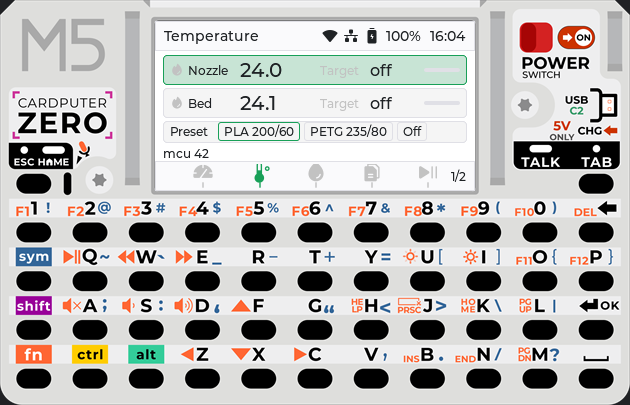
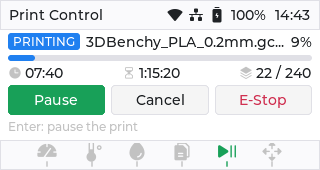
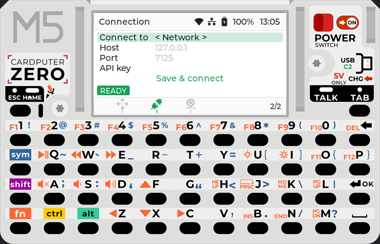
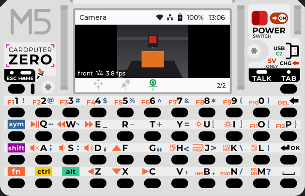

# KlipperDeckZero

English | [日本語](README.ja.md) | [简体中文](README.zh-CN.md)

An LVGL app for the M5Stack **CardputerZero** that lets you run a Klipper 3D printer from the device's screen and keyboard. Moonraker can run on the CardputerZero itself or on another machine on the same network.


- This is not an official app from M5Stack, Klipper or Moonraker.
- It is still in development (0.1.0). Bug reports and requests are welcome in [Issues](https://github.com/denchi-45/KlipperDeckZero/issues), in English, Japanese or Chinese.

> **Safety**
> This app heats the hotend and bed and moves the motors over the network. Do not use it while you are away from the printer. The app has an emergency stop, but keep the printer's own power switch within reach.

## Features

- Printer status: state, progress, elapsed and remaining time, layer, nozzle and bed temperatures, and a thumbnail of the file being printed
- Nozzle and bed target temperatures, with presets
- Extrude and retract filament
- Pick a G-code file and start a print
- Pause / resume, cancel, emergency stop
- Jog the axes, home, and turn the motors off
- Restart Klipper or the MCU
- Watch the printer's webcam (the webcams set up in Moonraker)

## Requirements

- An M5Stack CardputerZero (stock OS, arm64)
- A printer running [Klipper](https://www.klipper3d.org/) and [Moonraker](https://moonraker.readthedocs.io/). If you already use Mainsail or Fluidd, Moonraker is installed.
- If Klipper and Moonraker run on another computer, that computer and the CardputerZero must be on the same network

## Installation

### From the store

Search for "KlipperDeckZero" in the CardputerZero app store and install it (once it is published).

### From the .deb package

Download `klipper-deck-zero_<version>-rev1_arm64.deb` from [Releases](https://github.com/denchi-45/KlipperDeckZero/releases), copy it to the CardputerZero, and install it:

```sh
sudo apt install ./klipper-deck-zero_0.1.0-rev1_arm64.deb
```

KlipperDeckZero then shows up in the launcher. To build it yourself, see [Development](#development).

## Connecting to the printer

After starting the app, press `S` to open the connection settings and choose where to connect in "Connect to". Select an item and press `Enter` to edit it, then choose "Save & connect" to save and connect.

### Klipper running on the CardputerZero

Set "Connect to" to "This device" (the default). The app connects to Moonraker's Unix socket (`~/printer_data/comms/moonraker.sock` by default), so nothing needs to be set up on the Moonraker side. If the socket is somewhere else, change "Socket".

### A printer on the network

Set "Connect to" to "Network", enter the printer's IP address or host name in "Host" (for example `192.168.1.50` or `mainsailos.local`), and Moonraker's port in "Port" (usually `7125`).

Moonraker also has to accept the connection. Do one of the following:

- In `moonraker.conf` on the printer, add the CardputerZero's IP address, or your network's range, to `trusted_clients` in `[authorization]`. On a home network this is usually already there.

  ```ini
  [authorization]
  trusted_clients:
      192.168.1.0/24
  ```

- Or enter Moonraker's API key in "API key" on the KlipperDeckZero connection settings screen.

## Screens and controls

### Layout


Every screen uses the same frame.

- **Title bar**: the screen name on the left; network (Wi-Fi signal or wired), battery and clock on the right.
- **State badge**: the printer state (`OFFLINE` / `STARTING` / `READY` / `PRINTING` / `PAUSED` / `COMPLETE` / `CANCELLED` / `ERROR` / `SHUTDOWN`), color coded. On Status and Print control, the file name and a progress bar sit next to it.
- **Content area**: what each screen shows and the items you can operate. The selected item is green.
- **Bottom line**: a hint for the selected item, or messages such as errors. Status shows Speed / Flow / Fan here.
- **Nav bar**: five slots along the bottom of the screen, each sitting right above the `4` to `8` keys, so the slot lines up with the key you press. The slots are split into layers (two for now); `Sym`+`H` / `Sym`+`J` switch to the previous / next layer. The current layer (`1/2` and so on) is shown at the right end. The icon of the current screen is green (no icon is green if the current screen is not on the layer shown), and empty slots are blank and do nothing.
- **Toast**: results of an action (success or a Klipper error) and messages like "Printer is not ready" appear briefly at the bottom of the screen.
- **Theme**: `D` toggles light and dark.

> The screenshots in this README were taken with the desktop simulator connected to a fake Moonraker (fake_moonraker). They include the device frame and the virtual keyboard (the symbols on the keyboard show the simulator's key assignments). See [Screenshots](#screenshots) for how to retake them.

### Screens

| Layer | Key | Screen | What it does |
|---|---|---|---|
| 1 | `4` | Status (home) | State, progress, elapsed / remaining time, layer, nozzle and bed temperatures, speed, flow, fan |
| 1 | `5` | Temperature | Nozzle and bed targets, presets |
| 1 | `6` | Extrude / retract | Extrude and retract filament |
| 1 | `7` | Files | G-code file list and details, start a print |
| 1 | `8` | Print control | Pause / resume, cancel, emergency stop |
| 2 | `4` | Move | Jog, home, motors off |
| 2 | `5` | Connection settings (also `S`) | Where to connect (Klipper on this device or a printer on the network) |
| 2 | `6` | Camera | The printer's webcam |
| 2 | `7` to `8` | (empty) | Reserved for future screens |

Layers and screens are independent. Switching layers only changes the nav bar (which key opens which screen); the screen you are on stays. The screen changes only when you press `4` to `8`, `S` or `ESC`, and that never switches the layer.

| Layer 1 shown | `Sym`+`J` shows layer 2 |
|---|---|
|  |  |

From the right-hand state, `4` opens Move, `5` opens Connection settings and `6` opens Camera.

### Common keys

| Key | Action |
|---|---|
| `4` to `8` | Open the screen in that slot of the layer shown (see the table above) |
| `Sym`+`H` / `Sym`+`J` | Previous / next layer (`<` / `>` in the simulator) |
| `S` | Connection settings (the layer shown does not change) |
| `ESC` | Back to home (Status) (the layer shown does not change) |
| Hold `4` / `ESC` | Quit (only on the home screen; `4` only while layer 1 is shown) |
| `D` | Toggle light / dark |
| `R` / `F` | Restart Klipper (`RESTART`) / restart the MCU (`FIRMWARE_RESTART`). Press twice within 3 seconds on Status. Not run while Klipper is ready and printing or paused |
| `Fn`+`H` | Help |
| `Fn`+`J` | Screenshot (saved as PNG in `~/Pictures/Screenshots`; `PrintScreen` in the simulator) |

On each screen, `↑`/`↓` select an item, `←`/`→` change a value or option, and `Enter` runs it. While you are typing a number, the screen gets every key (typing `6` does not switch screens).

#### Status (layer 1, `4`)

| Printing (light) | Printing (dark) |
|---|---|
|  |  |


Shows the state badge, file name and progress (%), elapsed / remaining time and layer, the current and target temperatures and heater power of the nozzle and bed, and Speed / Flow / Fan on the bottom line. When nothing is printing it shows "No active print". While printing or paused, the file's thumbnail appears to the left of the top three rows (not in the desktop simulator, because the fake Moonraker returns empty `thumbnails` in the file metadata).

On this screen, pressing `R` / `F` twice within 3 seconds restarts Klipper / the MCU. This is not run while Klipper is ready and printing or paused. While Klipper is starting, disconnected, or in an error state (`error`, `shutdown`), the restart works even if the print state is stale, so you can use it to recover after Klipper has stopped.

#### Temperature (layer 1, `5`)



`↑`/`↓` select the nozzle, the bed or the presets (the bed row is hidden if the printer has no bed heater).

- Nozzle and bed: `←`/`→` change the target in steps of 5, and `Enter` lets you type a number. Press `Enter` again to send it, or `ESC` to cancel. The limits are 350 for the nozzle and 150 for the bed (Klipper's `max_temp` has the final say).
- Presets (PLA 200/60, PETG 235/80, Off): choose one with `←`/`→` and press `Enter` to set both heaters.

Targets are sent with `SET_HEATER_TEMPERATURE` and the result is shown in a toast. The bottom line shows the other temperature sensors (such as `temperature_sensor`) and the CPU temperature of the CardputerZero.

#### Extrude / retract (layer 1, `6`)


`↑`/`↓` select the length (1/5/10/25/50 mm), speed (2/5/10 mm/s) or direction (Retract / Extrude), and `←`/`→` change it. `Enter` runs it from any row. The top of the screen shows the nozzle temperature and whether it is hot enough to extrude.

- Not run: while printing, or while the nozzle is below the extrude temperature (Klipper's `min_extrude_temp`).
- Allowed while paused (for filament changes).

The app sends `SAVE_GCODE_STATE` → `M83` → `G1 E<±length> F<speed×60>` (`F` is in mm/min) → `RESTORE_GCODE_STATE`, so the print's extrusion mode is left as it was.

#### Files (layer 1, `7`)

| List | Details |
|---|---|
|  |  |

Lists the printer's G-code files, newest first (reloaded every time you open the screen). `↑`/`↓` select a file (`←`/`→` move by 5), and `Enter` shows its details: thumbnail, estimated time, filament, layer height and first-layer temperatures.

Press `Enter` again in the details to start the print; once it starts, the app goes back to Status. If it fails to start, a toast shows why and you stay on Files. `ESC` goes back to the list. A print is not started while another one is printing or paused.

#### Print control (layer 1, `8`)



The top shows the state badge, file name, progress, elapsed / remaining time and layer. `←`/`→` select a button.

- Pause / Resume: `Enter` pauses or resumes. While paused, the label reads Resume.
- Cancel: press `Enter` twice within 3 seconds to cancel. The first press turns the button red; any other key cancels the confirmation.
- E-Stop: hold `Enter` for an emergency stop (`printer.emergency_stop`). It is sent whenever Moonraker is connected, even if Klipper is not ready.

When nothing is printing, Pause and Cancel are grayed out and only show "No print is running". After an emergency stop, press `F` twice on Status to run `FIRMWARE_RESTART` and recover.

#### Move (layer 2, `4`)


`↑`/`↓` select an item (axis / step / `−` direction / `+` direction / home this axis / home all / motors off). The axis (X/Y/Z) and step (0.1/1/10/50 mm) change with `←`/`→`; the other items run with `Enter`. The top of the screen shows the toolhead position and which axes are homed ("Not homed", or "Homed" followed by the axis names).

- Jog: sends `SAVE_GCODE_STATE` → `G91` → `G1 <axis><±step> F<feed>` (XY 3000 / Z 600 mm/min) → `RESTORE_GCODE_STATE`, so the print's positioning mode is left as it was.
- Home: `G28` (all axes) / `G28 X` (one axis). Motors off: `M84`.

When an action is not run (the reason is shown in a toast and on the bottom line):

- While printing: everything.
- While paused: home and motors off (they would lose the pause position). Jogging works.
- Jogging an axis that is not homed: shows "Home the axis first".

#### Connection settings (layer 2, `5`, or `S`)



`↑`/`↓` select an item, `Enter` edits or confirms, `←`/`→` change an option, and `ESC` cancels the edit or goes back. You can connect to "This device" (Unix socket) or "Network" (WebSocket: Host and Port, plus an API key only if the CardputerZero is not in `trusted_clients`); "Save & connect" saves the settings and reconnects. The bottom line always shows the state badge, and next to it the connection state, or the save result or input error while there is one.

#### Camera (layer 2, `6`)



Shows the printer's webcam. The webcams are the ones set up in Moonraker, the same list Mainsail and Fluidd use (crowsnest, or `[webcam]` sections in `moonraker.conf`). The app downloads the webcam's still image (its snapshot URL) again and again, up to 4 times a second, and only while this screen is open. `←`/`→` switch between webcams and `Enter` pauses / resumes the image. The bottom left shows the webcam name, its place in the list and the frame rate. Rotation and flips set for the webcam in Moonraker are applied.

- A snapshot URL relative to the web frontend (such as `/webcam/?action=snapshot`) is fetched from port 80 of the printer host, or of this device when it connects through the Unix socket.
- A webcam without a snapshot URL (for example WebRTC only) and `https` URLs cannot be shown; the screen says so.

## Configuration file

What you save on the connection settings screen is written to the user configuration file. You can also edit it directly.

- Device: `/etc/klipper-deck-zero.conf` (defaults) and `~/.config/klipper-deck-zero/klipper-deck-zero.conf` (user settings; under `$XDG_CONFIG_HOME` instead if that is set)
- Desktop simulator: `config/klipper-deck-zero.conf`

```ini
[moonraker]
# unix: Klipper on this device / websocket: Klipper on another machine
# (default: unix on the device, websocket to 127.0.0.1 in the simulator)
transport=websocket
socket_path=~/printer_data/comms/moonraker.sock
# Where to connect with websocket (ws://<host>:<port>/websocket)
host=192.168.1.50
port=7125
# Only needed when the CardputerZero is not in trusted_clients
#api_key=
```

## Troubleshooting

- **Stays OFFLINE**: Check Host and Port. From a PC on the same network, open `http://<host>:7125/server/info` in a browser and see whether it answers. With "This device", check that Moonraker is running and that the socket file exists.
- **Connection refused by Moonraker**: Check that the CardputerZero is in Moonraker's `trusted_clients`, or that the API key is correct.
- **Stays STARTING / ERROR / SHUTDOWN**: The problem is on the Klipper side. Check the error in Mainsail or a similar interface. On Status, press `R` twice to restart Klipper or `F` twice to restart the MCU.

## Updating and uninstalling

To update, install the new .deb the same way. Your configuration files are kept.

```sh
sudo apt remove klipper-deck-zero   # remove the app (keeps the config file in /etc)
sudo apt purge klipper-deck-zero    # also remove the config file in /etc
```

The user settings file (`~/.config/klipper-deck-zero/klipper-deck-zero.conf`) is kept in both cases.

## Roadmap

1. ✅ Moonraker client + Status screen
2. ✅ Temperature, extrude / retract, files, print control and move screens
3. ✅ Camera screen
4. Switching the UI language (English, Japanese, Chinese)

## Development

Based on [CardputerZero/Template](https://github.com/CardputerZero/Template) (C++17 / LVGL 9.5 / CMake). The app talks to Moonraker over JSON-RPC: through the Unix socket or WebSocket on the device, and through WebSocket in the desktop simulator.

### Windows desktop simulator (MinGW)

Requirements: CMake 3.31+, Ninja, MinGW-w64 (WinLibs or similar), vcpkg (with `VCPKG_ROOT` set)

```powershell
cmake --preset win32-mingw64
cmake --build build/mingw64 --config Debug
./build/mingw64/Debug/klipper-deck-zero.exe
```

For MSVC, use the `win32-msvc` preset (`build/msvc`).

### Cross build and package for the CardputerZero

```sh
cmake --workflow --preset cp0-cross-package   # dist/klipper-deck-zero_*_arm64.deb
REMOTE_USER=pi REMOTE_HOST=192.168.1.20 ./deploy.sh
```

`deploy.sh` only builds the package and copies it to the home directory on the CardputerZero. Install it as described in [From the .deb package](#from-the-deb-package).

### Running without a printer (fake Moonraker)

The desktop build includes `fake_moonraker`. It simulates heating, the extrude temperature check, print progress, emergency stop and firmware restart.

```powershell
./build/mingw64/Debug/fake_moonraker.exe --speed 20   # ws://127.0.0.1:7125/websocket
./build/mingw64/Debug/klipper-deck-zero.exe
```

Add `--webcam <snapshot URL>` (repeatable) to list webcams on the Camera screen; the images come from any HTTP server you point it at.

To connect to a real printer, change `host` in `config/klipper-deck-zero.conf` to the printer's IP.

### Screenshots

`docs/images/screen-*.png` (for the README) and `screenshot/*.png` (for the store, 320x170) are taken with the desktop simulator connected to the fake Moonraker. After changing a screen, build Debug and retake them all with this script (port 7125 must be free):

```powershell
./tools/readme_screenshots/capture.ps1
```

The script sends key presses to the simulator window, and pastes each screen saved by the app's screenshot feature (320x170) onto the device frame image. The window does not need to be visible. A theme toggled with `D` is restored when the script ends.

### Tests

Unit tests for the parts that do not depend on LVGL: the Moonraker client (JSON-RPC, status merging, connection sequence), loading and saving settings, the logic of each screen (connection settings form, file list, temperature, extrude, print control, move), saving and restoring the G-code state, thumbnail selection, restart confirmation, nav bar layers and more. They can be built on their own without LVGL.

```powershell
ctest --test-dir build/mingw64 -C Debug            # included in the preset build
# or on their own
cmake -S tests -B build/tests -G Ninja && cmake --build build/tests && ./build/tests/kdz_tests
```

### Documents (Japanese only)

- [Design documents](docs/design/README.md) (how the connection works, design of the control screens)
- [Moonraker API × CardputerZero technical notes](docs/moonraker_tech_notes.md)

## License

[MIT License](LICENSE). The licenses of the libraries, fonts and icons used are listed in [THIRD_PARTY_NOTICES.md](THIRD_PARTY_NOTICES.md).
