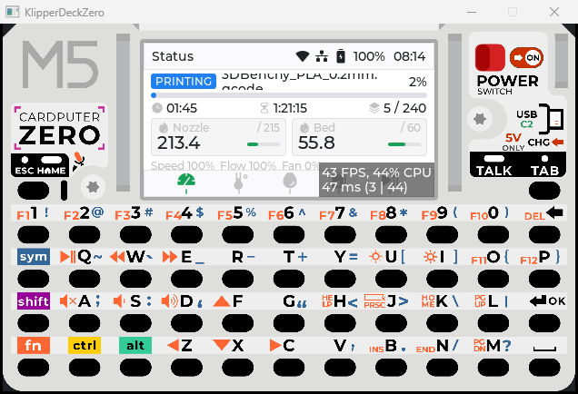
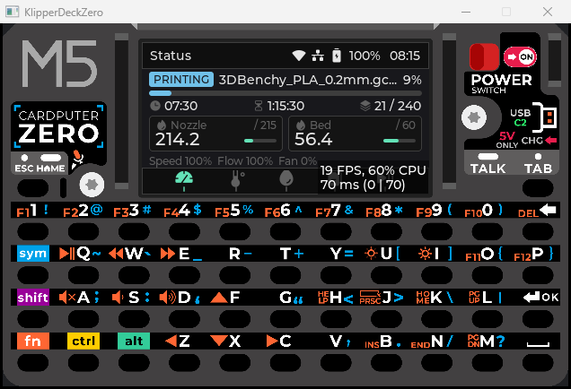
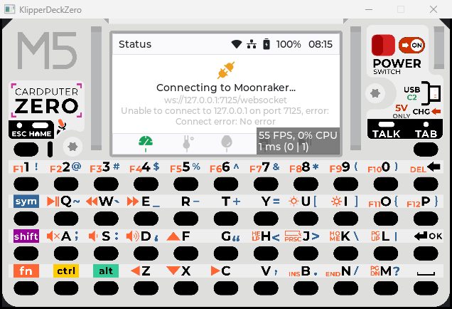
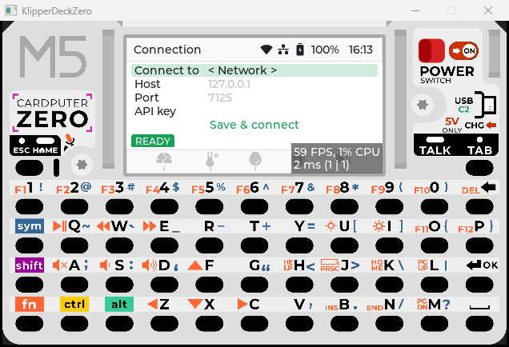

# KlipperDeckZero

M5Stack **CardputerZero** に Klipper / Moonraker を載せ、本体の画面とキーボードから 3D プリンターを操作するための LVGL アプリです。

> 🚧 開発中です。第1段階(通信層 + 状態表示)まで実装済みです。

## できるようにしたいこと

- プリンターの状態表示(状態、進捗、経過/残り時間、ノズル・ベッド温度など)
- G-code ファイルの選択と印刷開始、一時停止/再開/中止
- ホットエンド・ベッドの昇温指示
- フィラメントの押し出し(Extrude)と引き戻し(Retract)

## 構成

- ベース: [CardputerZero/Template](https://github.com/CardputerZero/Template)(C++17 / LVGL 9.5 / CMake)
- プリンター制御: [Moonraker](https://moonraker.readthedocs.io/) の JSON-RPC API
  - 実機: Unix ソケット(`~/printer_data/comms/moonraker.sock`)
  - デスクトップシミュレーター: WebSocket(`ws://<printer-ip>:7125/websocket`)

## 画面と操作

| 状態表示(ライト) | 状態表示(ダーク) |
|---|---|
|  |  |

| 接続待ち | 接続設定(`S`) |
|---|---|
|  |  |

| キー | 動作 |
|---|---|
| `4` | 状態表示(ホーム)。ホームで長押し or `ESC` 長押しで終了 |
| `5` / `6` / `7` / `8` | 温度設定 / 押し出し・引き戻し / ファイル選択と印刷開始 / 印刷制御 |
| `ESC` | ホームへ戻る |
| `S` | 接続設定(この端末の Klipper / ネットワーク上のプリンター) |
| `D` | ライト / ダーク切替 |
| `R` / `F` | Klipper 再起動(`RESTART`) / MCU 再起動(`FIRMWARE_RESTART`)。状態表示で 3 秒以内に 2 回押すと実行。印刷中・一時停止中は実行しない |
| `Fn`+`H` / `Fn`+`J` | ヘルプ / スクリーンショット(`~/Pictures/Screenshots` に PNG 保存。シミュレーターは `PrintScreen` キー) |

温度設定画面(`5`)では `↑`/`↓` でノズル・ベッド・プリセットを選びます。ノズル・ベッドは `←`/`→` で目標温度を 5 刻みで上下し、`Enter` で数字を打ち込めます。もう一度 `Enter` で送信、`ESC` で取消です。プリセット(PLA 200/60、PETG 235/80、Off)は `←`/`→` で選んで `Enter` で両方のヒーターに設定します。目標温度は `SET_HEATER_TEMPERATURE` で送り、結果をトーストで表示します。最下行には、ノズル・ベッド以外の温度センサー(`temperature_sensor` など)と、この端末の CPU 温度を表示します。

押し出し画面(`6`)では `↑`/`↓` で長さ(1/5/10/25/50 mm)・速度(2/5/10 mm/s)・向き(引き戻し / 押し出し)を選び、`←`/`→` で切り替えます。`Enter` でどの行からでも実行します。ノズルが押し出せる温度(Klipper の `min_extrude_temp`)に達していないときと印刷中は実行しません(一時停止中は実行できます)。`SAVE_GCODE_STATE` → `M83` → `G1 E<長さ> F<速度×60>`(`F` は mm/min) → `RESTORE_GCODE_STATE` を送るので、印刷側の押し出しモードは変わりません。

ファイル画面(`7`)には、プリンターの G-code ファイルを新しい順に並べます。`↑`/`↓` で選び(`←`/`→` で 5 件ずつ移動)、`Enter` で詳細(予想時間・フィラメント量・レイヤー高さ・初層温度)を表示し、もう一度 `Enter` で印刷を開始します。開始すると状態表示に戻ります。印刷中・一時停止中は開始しません。`ESC` で一覧に戻ります。

印刷制御画面(`8`)では `←`/`→` でボタンを選びます。「Pause / Resume」は `Enter` で一時停止・再開、「Cancel」は 3 秒以内に `Enter` を 2 回押すと中止、「E-Stop」は `Enter` を長押しすると非常停止(`printer.emergency_stop`)です。非常停止の後は、状態表示で `F` を 2 回押して `FIRMWARE_RESTART` すると復帰します。

接続設定画面では `↑`/`↓` で項目を選び、`Enter` で編集・確定、`←`/`→` で選択肢を切り替え、`ESC` で編集取消 / 戻るです。接続先は「このデバイス(Unix ソケット)」と「ネットワーク(WebSocket)」から選べ、「Save & connect」で保存して接続し直します。

## ロードマップ

1. ✅ Moonraker 通信層 + 状態表示画面
2. ✅ 温度設定、押し出し/引き戻し、ファイル選択、印刷制御の画面

## ビルド

[CardputerZero/Template](https://github.com/CardputerZero/Template) と同じ CMake Presets を使います。

### Windows デスクトップシミュレーター(MinGW)

前提: CMake 3.31+, Ninja, MinGW-w64(WinLibs など), vcpkg(`VCPKG_ROOT` を設定)

```powershell
cmake --preset win32-mingw64
cmake --build build/mingw64 --config Debug
./build/mingw64/Debug/klipper-deck-zero.exe
```

MSVC の場合は `win32-msvc` プリセット(`build/msvc`)を使います。

### 実機(CardputerZero)向けクロスビルド / パッケージ

```sh
cmake --workflow --preset cp0-cross-package   # dist/KlipperDeckZero_*_arm64.deb
REMOTE_USER=pi REMOTE_HOST=<ip> ./deploy.sh
```

## 設定ファイル

- デスクトップ: `config/klipper-deck-zero.conf`
- 実機: `/etc/klipper-deck-zero.conf`(ユーザー設定は `~/.config/klipper-deck-zero/klipper-deck-zero.conf`)

```ini
[moonraker]
# unix: この端末の Klipper / websocket: 別の機械の Klipper
# (既定: 実機=unix, シミュレーター=websocket で 127.0.0.1)
transport=websocket
socket_path=~/printer_data/comms/moonraker.sock
# websocket のときの接続先(ws://<host>:<port>/websocket)
host=192.168.1.50
port=7125
# trusted_clients に入っていない場合のみ
#api_key=
```

## プリンターなしで動かす(疑似 Moonraker)

デスクトップビルドには `fake_moonraker` が含まれます。ヒーター昇温・押し出し温度チェック・印刷進捗・非常停止・FW再起動を模擬します。

```powershell
./build/mingw64/Debug/fake_moonraker.exe --speed 20   # ws://127.0.0.1:7125/websocket
./build/mingw64/Debug/klipper-deck-zero.exe
```

実機につなぐ場合は `host=<プリンターIP>` に変更します。

## テスト

Moonraker クライアント(JSON-RPC / 状態マージ / 接続シーケンス)と設定読み込みのユニットテストです。LVGL なしでも単独でビルドできます。

```powershell
ctest --test-dir build/mingw64 -C Debug            # プリセットビルドに含まれる
# もしくは単独で
cmake -S tests -B build/tests -G Ninja && cmake --build build/tests && ./build/tests/kdz_tests
```

## ドキュメント

- [Moonraker API × CardputerZero 技術調査メモ](docs/moonraker_tech_notes.md)
