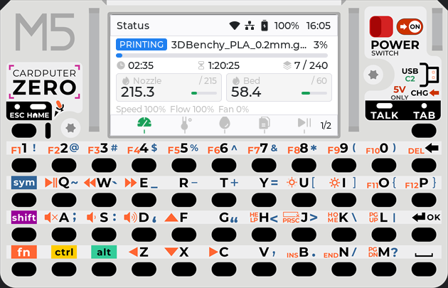
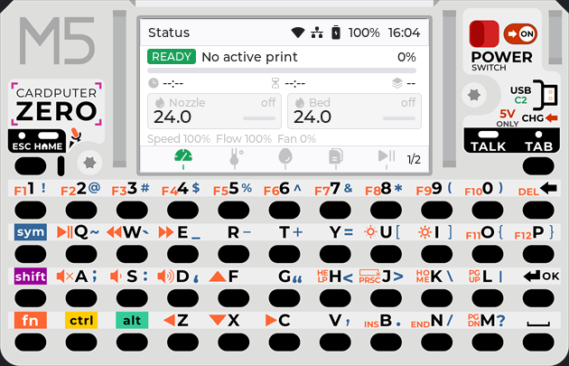
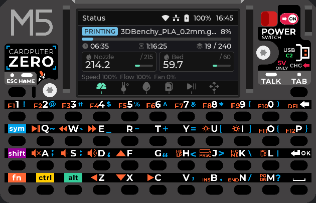
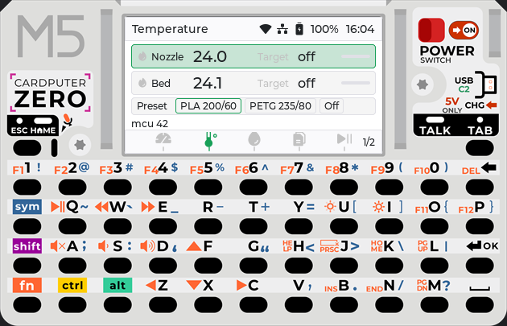
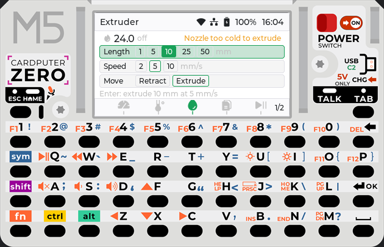
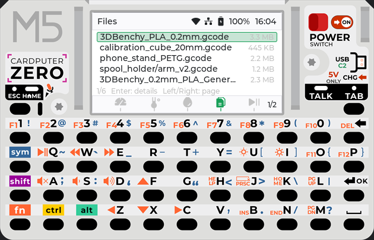
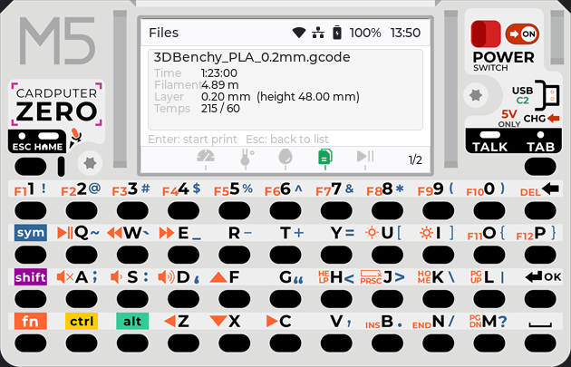
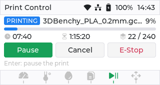
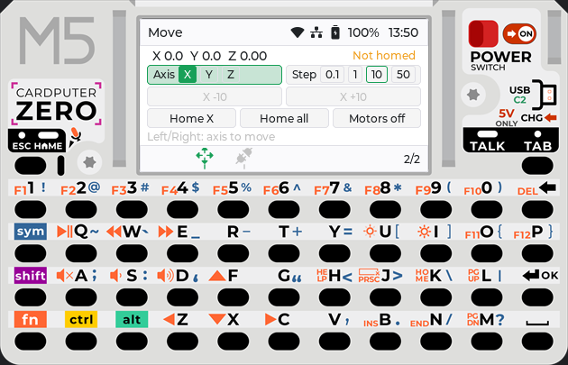
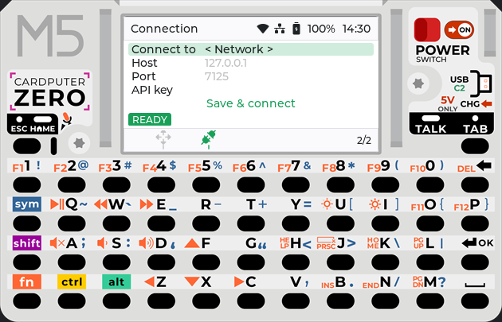

# KlipperDeckZero

[English](README.md) | [日本語](README.ja.md) | 简体中文

一个运行在 M5Stack **CardputerZero** 上的 LVGL 应用，用设备自带的屏幕和键盘操作 Klipper 3D 打印机。Moonraker 可以运行在 CardputerZero 本机上，也可以运行在同一网络中的另一台机器上。



- 本应用不是 M5Stack、Klipper 或 Moonraker 的官方应用。
- 目前仍在开发中（0.1.0）。问题和建议请提交到 [Issues](https://github.com/denchi-45/KlipperDeckZero/issues)，中文、英文、日文均可。

> **安全提示**
> 本应用会通过网络让热端和热床升温、让电机移动。请不要在无人看管打印机时使用。应用里有紧急停止，但请确保随时能切断打印机本身的电源。

## 功能

- 打印机状态：状态、进度、已用 / 剩余时间、层数、喷嘴和热床温度、正在打印的文件的缩略图
- 设置喷嘴和热床的目标温度，支持预设
- 挤出和回抽耗材
- 选择 G-code 文件并开始打印
- 暂停 / 继续、取消、紧急停止
- 移动各轴（点动）、归零、关闭电机
- 重启 Klipper 或 MCU

## 准备

- M5Stack CardputerZero（出厂系统，arm64）
- 运行 [Klipper](https://www.klipper3d.org/) 和 [Moonraker](https://moonraker.readthedocs.io/) 的打印机。如果你已经在用 Mainsail 或 Fluidd，Moonraker 就已经装好了。
- 如果 Klipper 和 Moonraker 运行在另一台电脑上，这台电脑和 CardputerZero 需要连在同一网络中

## 安装

### 从应用商店安装

在 CardputerZero 的应用商店中搜索 “KlipperDeckZero” 并安装（上架后可用）。

### 从 .deb 安装包安装

从 [Releases](https://github.com/denchi-45/KlipperDeckZero/releases) 下载 `KlipperDeckZero_<版本>_rev1_arm64.deb`，复制到 CardputerZero 上，然后执行：

```sh
sudo apt install ./KlipperDeckZero_0.1.0_rev1_arm64.deb
```

安装后，启动器中会出现 KlipperDeckZero。如需自己编译，请看[开发](#开发)。

## 连接打印机

启动应用后按 `S` 打开连接设置，在 “Connect to” 中选择连接目标。选中某一项后按 `Enter` 编辑，最后选择 “Save & connect” 保存并连接。

### 连接 CardputerZero 本机上的 Klipper

把 “Connect to” 设为 “This device”（默认值）。应用会连接 Moonraker 的 Unix 套接字（默认 `~/printer_data/comms/moonraker.sock`），Moonraker 一侧不需要额外设置。如果套接字在别的位置，请修改 “Socket”。

### 连接网络上的打印机

把 “Connect to” 设为 “Network”，在 “Host” 中填写打印机的 IP 地址或主机名（例如 `192.168.1.50`、`mainsailos.local`），在 “Port” 中填写 Moonraker 的端口（通常是 `7125`）。

另外，Moonraker 需要允许这个连接。请做以下任意一项设置：

- 在打印机一侧的 `moonraker.conf` 中，把 CardputerZero 的 IP 地址或所在网段加入 `[authorization]` 的 `trusted_clients`。家庭网络一般已经包含在内。

  ```ini
  [authorization]
  trusted_clients:
      192.168.1.0/24
  ```

- 或者在 KlipperDeckZero 连接设置的 “API key” 中填写 Moonraker 的 API 密钥。

## 界面和操作

### 界面布局


所有界面都使用同样的框架。

- **标题栏**：左边是界面名称，右边是网络（Wi-Fi 信号强度或有线）、电量和时钟。
- **状态标签**：用不同颜色显示打印机状态（`OFFLINE` / `STARTING` / `READY` / `PRINTING` / `PAUSED` / `COMPLETE` / `CANCELLED` / `ERROR` / `SHUTDOWN`）。在状态界面和打印控制界面，旁边会显示文件名和进度条。
- **内容区**：各界面的显示内容和操作项。当前选中的项显示为绿色。
- **最下一行**：当前选中项的操作提示，或错误等消息。状态界面在这里显示 Speed / Flow / Fan。
- **导航栏**：屏幕底部有 5 个槽位，每个槽位正好位于键盘 `4` 到 `8` 键的上方，和要按的键位置对应。槽位分为多层（目前 2 层），`Sym`+`H` / `Sym`+`J` 切换到上一层 / 下一层。右端显示当前层（如 `1/2`）。当前界面的图标为绿色（如果当前界面不在显示的这一层，就没有绿色图标），空槽位为空白，不能选择。
- **提示条（Toast）**：操作结果（成功或 Klipper 的错误）以及 “Printer is not ready” 等消息会在屏幕下方短暂显示。
- **主题**：按 `D` 在浅色和深色之间切换。

> 本 README 中的截图是将桌面模拟器连接到模拟 Moonraker（fake_moonraker）后拍摄的，包含设备外框和虚拟键盘（键盘上的符号表示模拟器中的按键分配）。重新截图的方法见[截图](#截图)。

### 界面列表

| 层 | 按键 | 界面 | 作用 |
|---|---|---|---|
| 1 | `4` | 状态（主界面） | 状态、进度、已用 / 剩余时间、层数、喷嘴和热床温度、速度、流量、风扇 |
| 1 | `5` | 温度 | 喷嘴和热床的目标温度、预设 |
| 1 | `6` | 挤出 / 回抽 | 挤出和回抽耗材 |
| 1 | `7` | 文件 | G-code 文件列表和详情、开始打印 |
| 1 | `8` | 打印控制 | 暂停 / 继续、取消、紧急停止 |
| 2 | `4` | 移动 | 点动、归零、关闭电机 |
| 2 | `5` | 连接设置（也可按 `S`） | 连接目标（本机的 Klipper 或网络上的打印机） |
| 2 | `6` 到 `8` | （空） | 留给以后的界面 |

层和界面互不影响。切换层只会改变导航栏（哪个键打开哪个界面），当前界面保持不变。只有按 `4` 到 `8`、`S` 或 `ESC` 时界面才会切换，而且这时也不会切换层。

| 显示第 1 层 | 按 `Sym`+`J` 显示第 2 层 |
|---|---|
|  |  |

在右图的状态下，按 `4` 打开移动界面，按 `5` 打开连接设置。

### 通用按键

| 按键 | 动作 |
|---|---|
| `4` 到 `8` | 打开当前显示层中该槽位的界面（见上表） |
| `Sym`+`H` / `Sym`+`J` | 上一层 / 下一层（模拟器中为 `<` / `>`） |
| `S` | 连接设置（显示的层不变） |
| `ESC` | 回到主界面（状态）（显示的层不变） |
| 长按 `4` / `ESC` | 退出（仅在主界面有效；`4` 仅在显示第 1 层时有效） |
| `D` | 切换浅色 / 深色 |
| `R` / `F` | 重启 Klipper（`RESTART`）/ 重启 MCU（`FIRMWARE_RESTART`）。在状态界面 3 秒内按两次执行。Klipper 处于 ready 且正在打印或暂停时不执行 |
| `Fn`+`H` | 帮助 |
| `Fn`+`J` | 截图（以 PNG 保存到 `~/Pictures/Screenshots`；模拟器中为 `PrintScreen` 键） |

在各界面中，`↑`/`↓` 选择项目，`←`/`→` 切换数值或选项，`Enter` 执行。正在输入数字时，所有按键都交给当前界面处理（输入 `6` 不会切换界面）。

#### 状态（第 1 层的 `4`）

| 打印中（浅色） | 打印中（深色） |
|---|---|
|  |  |


显示状态标签、文件名和进度（%）、已用 / 剩余时间和层数、喷嘴和热床的当前温度、目标温度和加热功率，最下一行显示 Speed / Flow / Fan。没有在打印时显示 “No active print”。打印中或暂停时，文件的缩略图会显示在上面三行的左侧（桌面模拟器中不显示，因为模拟 Moonraker 在文件元数据中返回的 `thumbnails` 为空）。

在这个界面 3 秒内按两次 `R` / `F`，会重启 Klipper / MCU。Klipper 处于 ready 且正在打印或暂停时不执行。当 Klipper 正在启动、未连接或处于错误状态（`error`、`shutdown`）时，即使打印状态还是旧的也可以重启，可用于 Klipper 停止后的恢复。

#### 温度（第 1 层的 `5`）



用 `↑`/`↓` 选择喷嘴、热床或预设（没有热床的机器不显示热床这一行）。

- 喷嘴和热床：`←`/`→` 以 5 为单位调整目标温度，按 `Enter` 可以直接输入数字。再按一次 `Enter` 发送，按 `ESC` 取消。上限为喷嘴 350、热床 150（实际上限由 Klipper 的 `max_temp` 决定）。
- 预设（PLA 200/60、PETG 235/80、Off）：用 `←`/`→` 选择，按 `Enter` 同时设置两个加热器。

目标温度通过 `SET_HEATER_TEMPERATURE` 发送，结果显示在提示条中。最下一行显示喷嘴和热床以外的温度传感器（如 `temperature_sensor`）以及本机的 CPU 温度。

#### 挤出 / 回抽（第 1 层的 `6`）



用 `↑`/`↓` 选择长度（1/5/10/25/50 mm）、速度（2/5/10 mm/s）或方向（Retract / Extrude），用 `←`/`→` 切换。在任意一行按 `Enter` 都会执行。界面上方显示喷嘴温度以及当前能否挤出。

- 不执行：正在打印时，或喷嘴温度低于可挤出温度（Klipper 的 `min_extrude_temp`）时。
- 暂停时可以执行（用于更换耗材）。

应用会依次发送 `SAVE_GCODE_STATE` → `M83` → `G1 E<±长度> F<速度×60>`（`F` 的单位是 mm/min）→ `RESTORE_GCODE_STATE`，因此不会改变打印任务的挤出模式。

#### 文件（第 1 层的 `7`）

| 列表 | 详情 |
|---|---|
|  |  |

按从新到旧的顺序列出打印机上的 G-code 文件（每次打开界面都会重新获取）。用 `↑`/`↓` 选择（`←`/`→` 每次移动 5 项），按 `Enter` 显示详情：缩略图、预计时间、耗材用量、层高和首层温度。

在详情中再按一次 `Enter` 开始打印，开始成功后返回状态界面。开始失败时提示条会显示原因，并停留在文件界面。按 `ESC` 返回列表。正在打印或暂停时不会开始新的打印。

#### 打印控制（第 1 层的 `8`）



上方显示状态标签、文件名、进度、已用 / 剩余时间和层数。用 `←`/`→` 选择按钮。

- Pause / Resume：按 `Enter` 暂停或继续。暂停时按钮文字变为 Resume。
- Cancel：3 秒内按两次 `Enter` 取消打印。第一次按下后按钮变红，按其他键则放弃取消。
- E-Stop：长按 `Enter` 紧急停止（`printer.emergency_stop`）。只要连着 Moonraker，即使 Klipper 不在 ready 状态也会发送。

没有在打印时，Pause 和 Cancel 显示为灰色，按下只会提示 “No print is running”。紧急停止之后，在状态界面按两次 `F` 执行 `FIRMWARE_RESTART` 即可恢复。

#### 移动（第 2 层的 `4`）



用 `↑`/`↓` 选择项目（轴 / 步长 / `−` 方向 / `+` 方向 / 该轴归零 / 全部归零 / 关闭电机）。轴（X/Y/Z）和步长（0.1/1/10/50 mm）用 `←`/`→` 切换，其他项目按 `Enter` 执行。界面上方显示工具头位置和已归零的轴（“Not homed”，或 “Homed” 加上轴名）。

- 点动：依次发送 `SAVE_GCODE_STATE` → `G91` → `G1 <轴><±步长> F<速度>`（XY 3000 / Z 600 mm/min）→ `RESTORE_GCODE_STATE`，因此不会改变打印任务的定位模式。
- 归零：`G28`（全部轴）/ `G28 X`（单个轴）。关闭电机：`M84`。

以下情况不执行（原因会显示在提示条和最下一行）：

- 正在打印：全部不执行。
- 暂停中：归零和关闭电机（会丢失暂停位置）。点动可以执行。
- 点动未归零的轴：提示 “Home the axis first”。

#### 连接设置（第 2 层的 `5`，或按 `S`）



`↑`/`↓` 选择项目，`Enter` 编辑或确认，`←`/`→` 切换选项，`ESC` 取消编辑或返回。连接目标可以选择 “This device”（Unix 套接字）或 “Network”（WebSocket，需要 Host / Port / API key），选择 “Save & connect” 保存并重新连接。最下一行始终显示状态标签，旁边通常显示连接状态，有保存结果或输入错误时显示相应消息。

## 配置文件

在连接设置界面保存的内容会写入用户配置文件。也可以直接编辑。

- 设备：`/etc/klipper-deck-zero.conf`（默认值）和 `~/.config/klipper-deck-zero/klipper-deck-zero.conf`（用户设置；如果设置了 `XDG_CONFIG_HOME`，则在其下）
- 桌面模拟器：`config/klipper-deck-zero.conf`

```ini
[moonraker]
# unix: 本机上的 Klipper / websocket: 其他机器上的 Klipper
# （默认：设备上为 unix，模拟器中为 websocket 连接 127.0.0.1）
transport=websocket
socket_path=~/printer_data/comms/moonraker.sock
# 使用 websocket 时的连接地址（ws://<host>:<port>/websocket）
host=192.168.1.50
port=7125
# 仅在 CardputerZero 不在 trusted_clients 中时需要
#api_key=
```

## 连接不上时

- **一直显示 OFFLINE**：请检查 Host 和 Port。在同一网络中的电脑浏览器里打开 `http://<host>:7125/server/info`，看是否有响应。使用 “This device” 时，请确认 Moonraker 正在运行，并且套接字文件存在。
- **Moonraker 拒绝连接**：请确认 CardputerZero 已加入 Moonraker 的 `trusted_clients`，或 API 密钥是否正确。
- **一直显示 STARTING / ERROR / SHUTDOWN**：这是 Klipper 一侧的问题。请在 Mainsail 等界面中查看错误内容。在状态界面按两次 `R` 可重启 Klipper，按两次 `F` 可重启 MCU。

## 更新和卸载

更新时，按同样的步骤安装新的 .deb 即可，配置文件会保留。

```sh
sudo apt remove klipper-deck-zero   # 删除应用（保留 /etc 中的配置文件）
sudo apt purge klipper-deck-zero    # 同时删除 /etc 中的配置文件
```

用户设置文件（`~/.config/klipper-deck-zero/klipper-deck-zero.conf`）在两种情况下都会保留。

## 路线图

1. ✅ Moonraker 通信层 + 状态界面
2. ✅ 温度、挤出 / 回抽、文件、打印控制、移动界面
3. 切换界面语言（英文、日文、中文）

## 开发

基于 [CardputerZero/Template](https://github.com/CardputerZero/Template)（C++17 / LVGL 9.5 / CMake）。应用通过 JSON-RPC 与 Moonraker 通信：在设备上使用 Unix 套接字或 WebSocket，在桌面模拟器中使用 WebSocket。

### Windows 桌面模拟器（MinGW）

需要：CMake 3.31+、Ninja、MinGW-w64（WinLibs 等）、vcpkg（设置 `VCPKG_ROOT`）

```powershell
cmake --preset win32-mingw64
cmake --build build/mingw64 --config Debug
./build/mingw64/Debug/klipper-deck-zero.exe
```

使用 MSVC 时，请用 `win32-msvc` 预设（`build/msvc`）。

### 为 CardputerZero 交叉编译和打包

```sh
cmake --workflow --preset cp0-cross-package   # dist/KlipperDeckZero_*_arm64.deb
REMOTE_USER=pi REMOTE_HOST=192.168.1.20 ./deploy.sh
```

`deploy.sh` 只负责打包并复制到 CardputerZero 的主目录。安装请按[从 .deb 安装包安装](#从-deb-安装包安装)的步骤进行。

### 不接打印机运行（模拟 Moonraker）

桌面版构建中包含 `fake_moonraker`，可以模拟加热、挤出温度检查、打印进度、紧急停止和固件重启。

```powershell
./build/mingw64/Debug/fake_moonraker.exe --speed 20   # ws://127.0.0.1:7125/websocket
./build/mingw64/Debug/klipper-deck-zero.exe
```

要连接真实的打印机，请把 `config/klipper-deck-zero.conf` 中的 `host` 改为打印机的 IP。

### 截图

`docs/images/screen-*.png`（README 用）和 `screenshot/*.png`（应用商店用，320x170）是将桌面模拟器连接到模拟 Moonraker 后拍摄的。修改界面后，先构建 Debug 版，再用下面的脚本全部重新截图（请确保 7125 端口未被占用）：

```powershell
./tools/readme_screenshots/capture.ps1
```

脚本会向模拟器窗口发送按键，把应用截图功能保存的画面（320x170）叠加到设备外框图片上保存。窗口不需要显示在屏幕上。用 `D` 切换的主题会在脚本结束时恢复。

### 测试

针对不依赖 LVGL 的部分的单元测试：Moonraker 客户端（JSON-RPC、状态合并、连接流程）、设置的读取和保存、各界面的操作逻辑（连接设置表单、文件列表、温度、挤出、打印控制、移动）、G-code 状态的保存和恢复、缩略图的选择、重启确认、导航栏的层等。没有 LVGL 也能单独构建。

```powershell
ctest --test-dir build/mingw64 -C Debug            # 包含在预设构建中
# 或单独构建
cmake -S tests -B build/tests -G Ninja && cmake --build build/tests && ./build/tests/kdz_tests
```

### 文档（仅日文）

- [设计文档](docs/design/README.md)（连接机制、操作界面的设计）
- [Moonraker API × CardputerZero 技术调研笔记](docs/moonraker_tech_notes.md)

## 许可证

[MIT License](LICENSE)。所用库、字体和图标的许可证列在 [THIRD_PARTY_NOTICES.md](THIRD_PARTY_NOTICES.md) 中。
